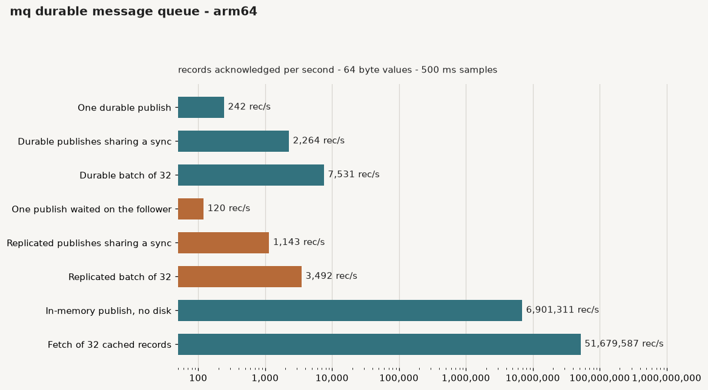

# mq

A small distributed message broker written in Go. Topics are split across multiple partitions by key hash. Records live on disk in a write-ahead log. Standalone mode restarts to a consistent state; follower mode anchors a second copy; three-node cluster runs raft with automatic leader election and majority commit.

Speaks HTTP and JSON. Consumers in a group join to receive balanced partition assignments.

## Run it

```sh
go run ./cmd/mqd -listen 127.0.0.1:8080
```

Or with several partitions per topic:

```sh
go run ./cmd/mqd -listen 127.0.0.1:8080 -partitions 6
```

Data goes in `./mq-data`. Pass `-data` to change that. The server is plain HTTP on localhost; non-loopback listeners require TLS and a client token.

## Publish and read

Every call is `POST` with one JSON object. `key` and `value` are base64. Records are stored in a partition selected by the key's hash.

| Endpoint | What you send | What it does |
| --- | --- | --- |
| `/v1/publish` | `topic`, `key`, `value`, optional `request_id` | Append one record to the partition that matches the key. |
| `/v1/publish-batch` | `topic`, `messages`, optional `request_id` | Append up to 32 records in one fsync. |
| `/v1/fetch` | `topic`, `offset`, `limit` | Read records from an offset. Pass `partitions` to get only specific partitions. |
| `/v1/groups/fetch` | `group`, `topic`, `limit` | Read records from the group's committed offset. |
| `/v1/groups/join` | `group`, `topic` | Join a group, receive member id and assigned partitions. |
| `/v1/groups/heartbeat` | `group`, `topic`, `member_id` | Refresh the member's lease. |
| `/v1/groups/leave` | `group`, `topic`, `member_id` | Resign and trigger a partition reassignment across remaining members. |
| `/v1/groups/members` | query `group=...&topic=...` | List active members and their partition assignments. |
| `/v1/groups/commit` | `group`, `topic`, `next_offset` | Commit the offset the group should read next. |
| `/v1/topics/retain` | `topic`, `start_offset` | Move a topic's start offset. Admin token required. |
| `/v1/snapshot` | empty body | Write a recovery snapshot. Admin token required. |

Request ids give at-least-once delivery: a retry with the same id returns the original offset. The same id with different bytes returns 409.

Messages are at most 256 KiB key+value. Batches are at most 32 records. Topic names, group names, and request ids are at most 255 bytes.

Pass `-retention-max-age=24h` to age-expire records automatically (zero means disabled). Records older than the window are dropped from the oldest end; the age comes from each record's publish timestamp. Operator retention via `/v1/topics/retain` works the same way and is durable through the replication/raft log path.

## Run a cluster

Primary-backup replication (follower first):

```sh
go run ./cmd/mqd -role follower -listen 127.0.0.1:8081 -data ./follower-data -replication-token 'replace-with-a-long-random-token'
go run ./cmd/mqd -role leader -listen 127.0.0.1:8080 -data ./leader-data -replica http://127.0.0.1:8081 -replication-token 'replace-with-a-long-random-token' -epoch 1
```

Three-node Raft cluster (any odd number of nodes works):

```sh
export MQ_RAFT_TOKEN='replace-with-a-long-random-token'
go run ./cmd/mqd -role cluster -listen 127.0.0.1:8081 -data ./node-1-data \
  -raft-peers http://127.0.0.1:8081,http://127.0.0.1:8082,http://127.0.0.1:8083 -raft-self 0 -raft-token "$MQ_RAFT_TOKEN"
go run ./cmd/mqd -role cluster -listen 127.0.0.1:8082 -data ./node-2-data \
  -raft-peers http://127.0.0.1:8081,http://127.0.0.1:8082,http://127.0.0.1:8083 -raft-self 1 -raft-token "$MQ_RAFT_TOKEN"
go run ./cmd/mqd -role cluster -listen 127.0.0.1:8083 -data ./node-3-data \
  -raft-peers http://127.0.0.1:8081,http://127.0.0.1:8082,http://127.0.0.1:8083 -raft-self 2 -raft-token "$MQ_RAFT_TOKEN"
```

A client may publish or fetch from any node. Followers redirect to the current leader with HTTP 307. To find the leader:

```sh
curl -H "X-Raft-Token: $MQ_RAFT_TOKEN" http://127.0.0.1:8081/raft/role
```

Every write is acknowledged only after a majority has committed it.

## Grow the cluster at runtime

A fresh node joins as a non-voting learner: start it with `-raft-learner` so it waits for the cluster instead of campaigning on its own (which could otherwise disrupt the running leader).

```sh
export MQ_ADMIN_TOKEN='replace-with-a-long-random-token'
go run ./cmd/mqd -role cluster -listen 127.0.0.1:8084 -data ./node-4-data \
  -raft-peers http://127.0.0.1:8081,http://127.0.0.1:8082,http://127.0.0.1:8083,http://127.0.0.1:8084 -raft-self 3 \
  -raft-learner -raft-token "$MQ_RAFT_TOKEN" -admin-token "$MQ_ADMIN_TOKEN"
```

Ask the current leader to add it (as non-voting):

```sh
curl -X POST -H "Authorization: Bearer $MQ_ADMIN_TOKEN" -H 'Content-Type: application/json' \
  -d '{"url":"http://127.0.0.1:8084"}' http://127.0.0.1:8081/v1/admin/cluster/add-node
```

Promote it to voter once it has caught up:

```sh
curl -X POST -H "Authorization: Bearer $MQ_ADMIN_TOKEN" -H 'Content-Type: application/json' \
  -d '{"index":3}' http://127.0.0.1:8081/v1/admin/cluster/promote-node
```

Remove a node:

```sh
curl -X POST -H "Authorization: Bearer $MQ_ADMIN_TOKEN" -H 'Content-Type: application/json' \
  -d '{"index":3}' http://127.0.0.1:8081/v1/admin/cluster/remove-node
```

List current members and votes:

```sh
curl -H "Authorization: Bearer $MQ_ADMIN_TOKEN" http://127.0.0.1:8081/v1/admin/cluster/members
```

## Performance

Measured on Apple M5 (darwin/arm64), 64-byte payloads, `-benchtime=500ms -count=1`. Durable paths are bound by fsync latency, not CPU.



Reproduce and redraw the chart:

```sh
python3 -m venv bench/.venv && bench/.venv/bin/pip install -r bench/requirements.txt
make bench
make chart
```

`make bench` runs the benchmark suites with `-benchtime=500ms -count=1` and writes `bench/broker.bench`, `bench/replication.bench`, and `bench/cluster.bench`. `make chart` renders `docs/performance.png` from the broker and replication benches using `matplotlib` (`bench/render_chart.py`). Cluster numbers land in `bench/cluster.bench` and are not plotted; cluster publishes are the slow path — a raft majority commit across three fsyncs (measured: ~12 ms per publish, ~82 rec/s serially, ~2.6k records/s for batch of 32).

On the Apple M5 with default fsync: durable single-node is ~240 rec/s serially, ~2.3k rec/s with shared group commit, ~7.5k rec/s in a batch of 32. The replicated follower path pays one synchronous round trip: ~120 rec/s serially, ~1.1k rec/s shared-sync, ~3.5k rec/s batch of 32. Fetching is RAM-bound at ~3.7 GB/s.

## Limits

- At-least-once delivery; not exactly-once.
- Topics are multiple partitions but all partitions share one WAL file per topic (no per-partition WAL yet).
- Consumer group membership is in-memory; a restart of all members resets assignments.
- Cluster membership can grow and shrink at runtime through `add-node`, `promote-node`, and `remove-node` (admin token required). Removed members are excluded from quorum immediately; the removed node stops receiving writes.
- Snapshot restore is full broker state; request-id state is preserved.
- Standalone (single-node) is lean and fast. Follower mode pairs durability with a minor latency cost; cluster mode gives automatic failover but is the slowest path — every write is a majority agreement across fsyncs.

## License

MIT. See [LICENSE](LICENSE).
